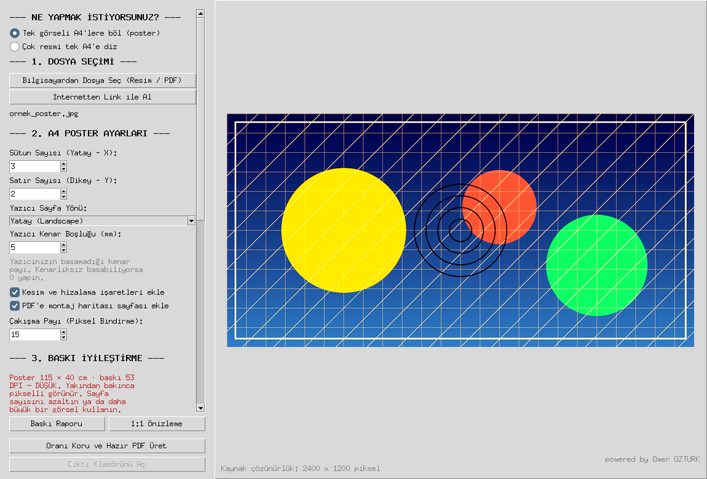

# Poster Basım — görseli A4 kağıtlara bölüp poster olarak yazdırma programı

Bir resmi ya da PDF'i **oranını bozmadan A4 sayfalara böler**, kesip yapıştırdığınızda
birleşen baskıya hazır tek PDF üretir. Windows, macOS ve Linux için ücretsiz, açık kaynak
masaüstü program; dosyanız hiçbir sunucuya yüklenmez.

**[Tanıtım sayfası ve indirme →](https://mustafasneu.github.io/poster-basim/)** ·
[English](https://mustafasneu.github.io/poster-basim/en/)

> Desktop app that splits an image or PDF across A4 sheets without distorting it and
> exports a print-ready PDF — an offline alternative to browser-based poster splitters.
> It also tiles many images onto a single A4 sheet.

İki modu var:

1. **Poster** — bir görseli **oranını bozmadan** A4 sayfalara böler, baskıya hazır tek PDF
   üretir. Sayfaları kesip yapıştırdığınızda tek büyük poster elde edersiniz.
2. **Dizme** — tersini yapar: **çok sayıda resmi tek A4 sayfaya** ızgara halinde dizer
   (katalog, ürün fotoğrafı, vesikalık). Resimler kırpılmaz, oranı korunarak hücreye
   sığdırılır.

**Windows, Linux ve macOS** üzerinde aynı şekilde çalışır. Kurulum gerektirmez: program
ilk açılışta eksik bileşenleri kendi klasörüne indirir, sisteminizdeki Python'a hiçbir şey
yazmaz.



## Ne yapar

- **Sünme yok** — görsel, sayfa matrisinin oranına doldurularak değil, oranı korunarak
  yerleştirilir; artan alan beyaz bırakılır. Daireler basık, yüzler uzamış çıkmaz.
- **Geniş dosya desteği** — JPG/PNG/BMP/WEBP/TIFF, **PSD** (Photoshop), **HEIC** (iPhone),
  **RAW** (CR2/NEF/ARW/DNG…), **PDF** ve **AI** (Illustrator). CMYK ve 16-bit kaynaklar
  baskıya uygun RGB'ye çevrilir.
- **PDF afiş desteği** — tasarım PDF olarak geldiyse doğrudan verin. PDF vektörel olduğu
  için sayfa 300 DPI'da taranır; ekran görüntüsü almaktan çok daha kaliteli çıkar. Çok
  sayfalı PDF'te hangi sayfanın poster olacağı sorulur.
- **Sürükle-bırak** — dosyayı pencerenin herhangi bir yerine bırakmanız yeterli. Poster
  modunda tek görsel açılır; birden çok dosya bırakırsanız bunları tek A4'e dizmek isteyip
  istemediğiniz sorulur. Dizme modunda her bırakış listeye ekler, öncekileri silmez.
- **Link ile alma** — görsel ya da PDF internetteyse indirmenize gerek yok; adresi
  yapıştırın, program indirip yükler.
- **Yazıcı kenar boşluğu** — yazıcıların basamadığı payı hesaba katar; poster ölçüsü ve
  DPI buna göre hesaplanır, parçalar kâğıtta gerçekten tutar.
- **Kesim ve montaj yardımı** — her sayfada kesim çizgisi, köşe işaretleri, hizalama
  artıları ve komşuluk etiketi; PDF'in başında montaj haritası sayfası.
- **Baskı raporu** — üretimden önce ölçü, DPI, kâğıt sayısı, kesilecek uzunluk ve uyarılar;
  çıktı klasörüne `baski_raporu.txt` olarak da yazılır.
- **1:1 gerçek boyut önizleme** — posterin bir bölgesini kâğıttaki ölçüsünde gösterir,
  ekran cetveliyle kalibre edilir.
- **Renk yönetimi** — gömülü ICC profili sRGB'ye çevrilir; kâğıt türüne göre (mat, parlak,
  fotokopi) renk ve kontrast telafisi.
- **Tek ölçek garantisi** — kenar parçalarında eksik kalan bindirme payı beyazla
  tamamlanır, böylece bütün sayfalar birebir aynı ölçekle basılır ve parçalar tutar.
- **Çakışma payı (bindirme)** — komşu sayfalarda tekrar basılan şerit sayesinde kesip
  yapıştırırken tolerans kalır.
- **Baskı iyileştirme** — profesyonel araçlar: **unsharp mask** (yarıçap / miktar / eşik),
  **otomatik seviye + beyaz dengesi**, **gürültü azaltma**, kontrast/renk/parlaklık.
  Görsel türüne göre hazır ayarlar (Fotoğraf, Grafik-Afiş, Tarama, Telefon).
- **Çözünürlük uyarısı** — seçtiğiniz sayfa sayısında posterin gerçek ölçüsünü ve baskı
  DPI'ını hesaplar; düşükse *baskıdan önce* uyarır. İsteğe bağlı **akıllı büyütme**
  (Lanczos + keskinleştirme) devreye girer.
- **AI ile büyütme (isteğe bağlı eklenti)** — küçük görsellerde kaybolan detayı yeniden
  üreten Swin2SR modeli. Programla gelmez; kullanıcı ilk kullanımda ~36 MB'lık eklentiyi
  kendisi indirir, indirmezse program klasik büyütmeyle çalışmaya devam eder. İşlem öncesi
  kendi makinenizde ölçülmüş süre tahmini sunulur, işlem durdurulabilir. Görseller
  bilgisayardan çıkmaz.
- **Dürüst önizleme** — keskinleştirme yarıçapı önizleme küçültmesine göre ölçeklenir;
  ekranda gördüğünüz keskinlik kâğıttakiyle aynıdır.
- **Baskı kalitesi** — parçalar JPEG kalite 95, renk alt örneklemesi kapalı (4:4:4),
  300 DPI etiketiyle kaydedilir.
- **Çıktı formatı seçenekleri** — baskıya hazır PDF her zaman üretilir; isteğe bağlı olarak
  yanına şunlar eklenir:
  - **Kayıpsız baskı** — PDF'e gömülen karolar JPEG yerine PNG (Flate) olur, yani PDF'te
    hiç JPEG artefaktı kalmaz. Afiş, logo ve yazıda kenar halkalanmasını bitirir; düz
    zeminli grafiklerde dosya JPEG'den küçük bile çıkar, asıl bedel fotoğrafta ödenir.
  - **Çok sayfalı TIFF** — matbaaların raster master olarak istediği format. Kayıpsız
    ZIP/deflate, 300 DPI etiketli, sayfa sırası PDF ile aynı. Sayfalar tek tek akıtılarak
    yazılır, hepsi belleğe alınmaz. Montaj haritası vektörel olduğu için yalnızca PDF'te
    bulunur. Klasik TIFF 4 GB'lık adres sınırına dayanırsa üretim durur ve uyarılırsınız.
  - **Sayfa PNG** — her sayfa ayrıca kayıpsız PNG olarak kaydedilir. Kayıpsız baskı zaten
    açıksa karolar PNG olduğu için ikinci kopya yazılmaz.

## Kurulum

Tek şart, bilgisayarda **Python 3.10 veya üstü** bulunmasıdır. Linux ve macOS'ta zaten
kuruludur; Windows'ta yoksa [python.org](https://www.python.org/downloads/) üzerinden bir
kez kurulur (kurulum ekranında **“Add python.exe to PATH”** ve **“tcl/tk and IDLE”**
işaretli kalsın).

**Terminal gerekmez.** [ZIP olarak indirin](https://github.com/mustafasneu/poster-basim/archive/refs/heads/main.zip),
çıkarın, sonra kendi sisteminizin dosyasına çift tıklayın:

| İşletim sistemi | Programı aç             | Masaüstü kısayolu koy (bir kez) |
| --------------- | ----------------------- | ------------------------------- |
| Windows 10 / 11 | `Poster Basim.bat`     | `Kisayol Olustur.bat`           |
| macOS 11+       | `Poster Basim.command` | `Kisayol Olustur.command`       |
| Linux           | `calistir.sh`           | `kisayol-olustur.sh`            |

macOS ilk açılışta “geliştirici doğrulanamadı” derse: dosyaya **sağ tık → Aç → Aç**.

Terminali tercih ederseniz:

```bash
git clone https://github.com/mustafasneu/poster-basim.git
cd poster-basim
python3 kurulum.py          # masaüstü kısayolu (--kaldir ile geri alınır)
./calistir.sh               # programı başlat
```

Kısayol her sistemin kendi biçiminde oluşur: Windows'ta `.lnk`, macOS'ta `.command`,
Linux'ta `.desktop` (uygulama menüsüne de eklenir).

İlk açılış, bileşenler indirildiği için ~30 saniye sürer ve internet gerektirir; sonraki
açılışlar anındadır.

## Kullanım

1. **Bilgisayardan Dosya Seç** ile görseli, tasarımı ya da PDF'i yükleyin, veya
   **İnternetten Link ile Al** ile web adresini yapıştırın. SVG/EPS/CDR dosyalarını
   tasarım programınızdan PDF olarak dışa aktarıp verin.
2. **Sütun** ve **satır** sayısını girerek poster ölçüsünü belirleyin (örn. 4 × 2 = 8 A4).
3. Gerekirse **çakışma payını** ayarlayın — kesip yapıştıracaksanız 20–30 iyi gelir.
4. Sürgülerle keskinlik / kontrast / renk ayarını yapın.
5. **Oranı Koru ve Hazır PDF Üret** deyin. Çıktı, masaüstünüzdeki
   `Poster_Parcalari` klasörüne tarih damgalı bir alt klasör olarak düşer:
   yazdırılacak PDF ve her parçanın JPEG hali.

> [!IMPORTANT]
> Yazdırırken **“Sayfaya Sığdır / Fit to Page”** seçeneğini **işaretlemeyin**. Her zaman
> **“Gerçek Boyut / Actual Size”** ya da **%100 ölçek** ile yazdırın. Aksi halde sayfalar
> farklı ölçekte basılır ve parçalar birleşmez.

## Ayrıntılı kılavuz

Ekran görüntülü tam kullanım kılavuzu depoda: **[KULLANIM_KILAVUZU.pdf](KULLANIM_KILAVUZU.pdf)**
(aynı içeriğin HTML hali: [KULLANIM_KILAVUZU.html](KULLANIM_KILAVUZU.html)). Kurulum,
adım adım kullanım, yazdırma ayarları, kesme-birleştirme ve sık karşılaşılan durumlar
orada anlatılıyor.

## Dosyalar

| Dosya                   | İşlevi                                              |
| ----------------------- | --------------------------------------------------- |
| `poster_bolme.py`         | Programın kendisi (arayüz, bölme, dizme, PDF)          |
| `kurulum.py`              | Masaüstü kısayolu oluşturucu (üç sistem)               |
| `Poster Basim.bat`        | Windows başlatıcısı                                     |
| `Poster Basim.command`    | macOS başlatıcısı                                       |
| `calistir.sh`             | Linux / macOS başlatıcısı                               |
| `Kisayol Olustur.bat`     | Windows kısayol oluşturucu                              |
| `Kisayol Olustur.command` | macOS kısayol oluşturucu                                |
| `kisayol-olustur.sh`      | Linux kısayol oluşturucu                                |
| `KULLANIM_KILAVUZU.pdf`   | Ekran görüntülü tam kılavuz                             |
| `manuel/`                 | Kılavuzu ve ekran görüntülerini üreten betikler         |
| `eklentiler/`             | AI modeli buraya iner (depoda yoktur, kullanıcı indirir) |

## Teknik

Python 3.10+, Tkinter (arayüz), [Pillow](https://python-pillow.org/) (görüntü işleme),
[ReportLab](https://www.reportlab.com/) (PDF üretimi), [pypdfium2](https://github.com/pypdfium2-team/pypdfium2)
(PDF/AI okuma), pillow-heif (HEIC), rawpy (RAW). Son üçü isteğe bağlıdır: kurulamazlarsa
program yine açılır, yalnızca ilgili biçim devre dışı kalır. Bağımlılıklar programın yanındaki `.venv`
klasörüne kurulur; sistem Python'ı değiştirilmez.

## Lisans

MIT — bkz. [LICENSE](LICENSE).

---

powered by Omer OZTURK
